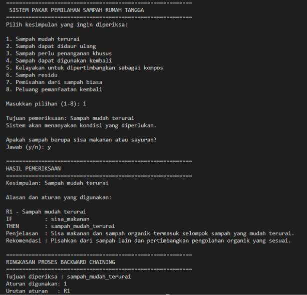
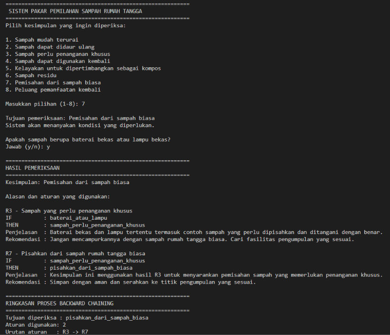
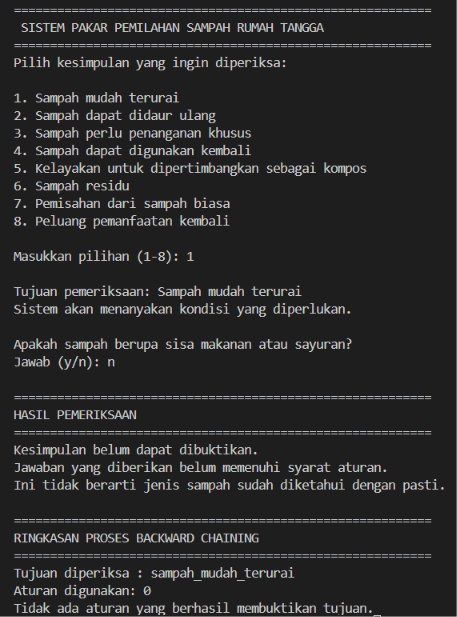

# Sistem Pakar Pemilahan Sampah Rumah Tangga Berdasarkan Karakteristik Sampah

**Nama:** Andrea Corina Rahmadi 
**NIM:** F1D02410104 
**Mata Kuliah:** Kecerdasan Buatan  
**Metode:** Backward Chaining

## 1. Topik

Sistem ini membantu mengidentifikasi kemungkinan kategori sampah rumah tangga berdasarkan karakteristik yang dijawab oleh pengguna, seperti sisa makanan, bahan yang dapat didaur ulang, dan baterai atau lampu bekas.

## 2. Cara Menjalankan Program

### Bahasa

- Python 3

### Langkah menjalankan

1. Buka folder proyek di Visual Studio Code.
2. Buka terminal pada folder proyek.
3. Jalankan program dengan perintah `python main.py`.
4. Pilih jenis kesimpulan yang ingin diperiksa.
5. Jawab pertanyaan menggunakan `y` untuk ya atau `n` untuk tidak.
6. Baca hasil kesimpulan dan aturan yang digunakan.

## 3. Sumber Pengetahuan

### Sumber 1 — Kementerian Lingkungan Hidup dan Kehutanan

Judul: Peraturan Menteri Lingkungan Hidup dan Kehutanan Nomor 14 Tahun 2021 tentang Pengelolaan Sampah pada Bank Sampah.

URL: https://jdih.menlhk.go.id/new2/uploads/files/2021pmlhk014_menlhk_07222021141822.pdf

Tanggal akses: 14 November 2026.

### Sumber 2 — Kementerian Lingkungan Hidup dan Kehutanan

Judul: Peraturan Menteri Lingkungan Hidup dan Kehutanan Nomor 9 Tahun 2024.

URL: https://jdih.menlhk.go.id/kiosk/files/PERMEN%20LHK_9_2024.pdf

Tanggal akses: 14 November 2026.

## 4. Basis Aturan

- R1 mengidentifikasi sampah mudah terurai berdasarkan keberadaan sisa makanan.
- R2 mengidentifikasi bahan yang berpotensi didaur ulang jika bersih dan kering.
- R3 mengidentifikasi baterai atau lampu bekas yang memerlukan penanganan khusus.
- R4 mengidentifikasi barang utuh yang berpotensi digunakan kembali.
- R5 mempertimbangkan kemungkinan pengolahan sampah mudah terurai menjadi kompos.
- R6 mengidentifikasi sampah yang tidak dapat dimanfaatkan sebagai residu.
- R7 menyimpulkan bahwa sampah yang memerlukan penanganan khusus perlu dipisahkan dari sampah biasa.
- R8 memeriksa peluang pemanfaatan kembali bahan yang berpotensi didaur ulang.

## 5. Metode

Sistem menggunakan metode Backward Chaining, yaitu penalaran yang dimulai dari kesimpulan yang ingin diperiksa, kemudian menelusuri aturan dan menanyakan fakta yang diperlukan untuk membuktikan kesimpulan tersebut.

Tahapan proses:

1. Pengguna memilih kesimpulan yang ingin diperiksa.
2. Sistem mencari aturan yang menghasilkan kesimpulan tersebut.
3. Sistem memeriksa kondisi aturan melalui pertanyaan kepada pengguna.
4. Jika kondisi membutuhkan kesimpulan lain, sistem memeriksa aturan terkait.
5. Sistem menampilkan kesimpulan jika kondisi terpenuhi atau menyatakan bahwa kesimpulan belum dapat dibuktikan.
6. Sistem menampilkan aturan yang digunakan sebagai alasan hasil.

## 6. Screenshot

### Dokumentasi Pengujian

**Pengujian 1 — Sampah mudah terurai**

**Pengujian 2 — Sampah yang perlu penanganan khusus**

**Pengujian 3 — Tidak ditemukan kesimpulan**

## 7. Keterbatasan Sistem

Sistem menggunakan aturan yang telah ditentukan dan bergantung pada jawaban pengguna. Program tidak memeriksa kondisi sampah secara langsung. Hasilnya merupakan perkiraan berdasarkan basis aturan yang tersedia, sehingga pemilahan dan penanganan sampah tetap perlu disesuaikan dengan jenis bahan serta ketentuan fasilitas pengelolaan sampah setempat.

## 8. Penggunaan AI

AI digunakan untuk memahami metode Backward Chaining, menyusun rancangan aturan, dan mengembangkan kode.